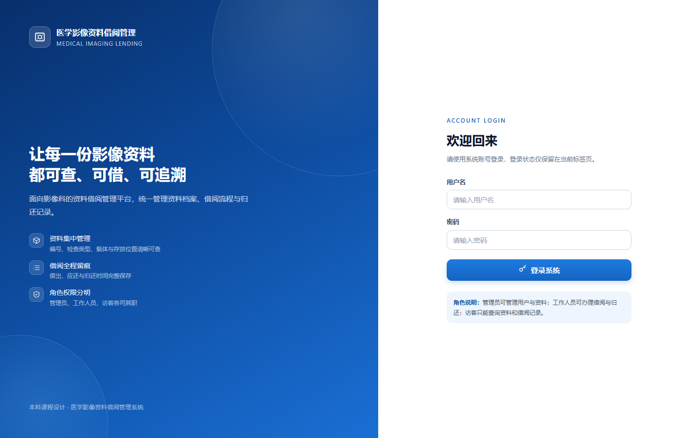
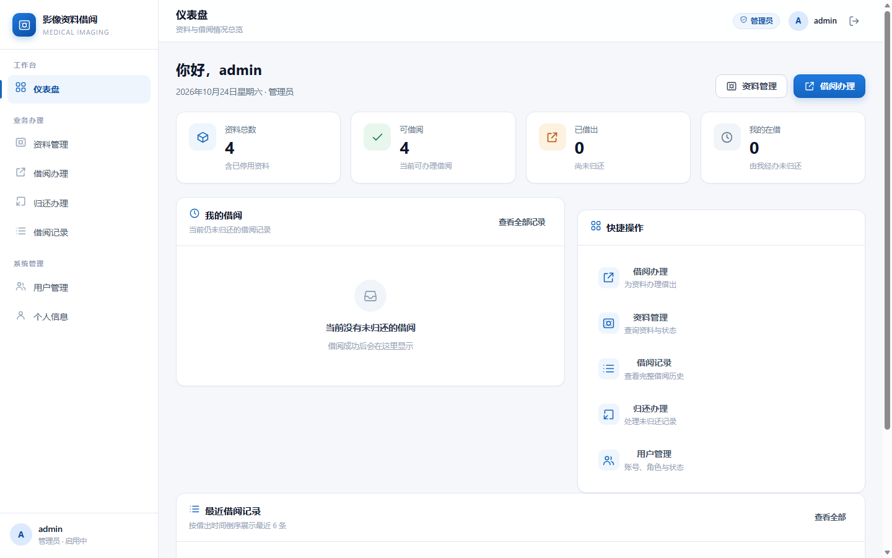
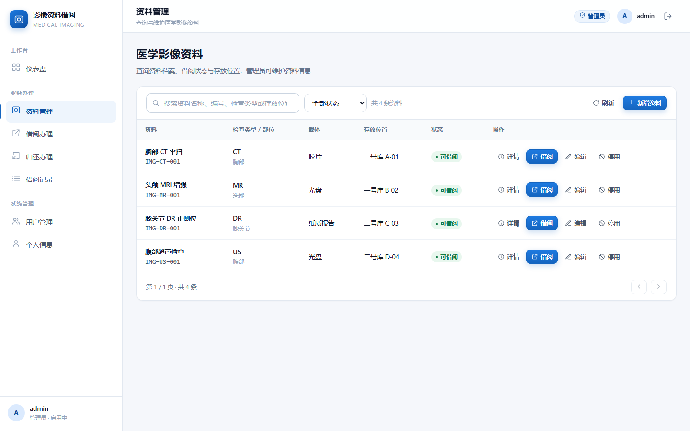
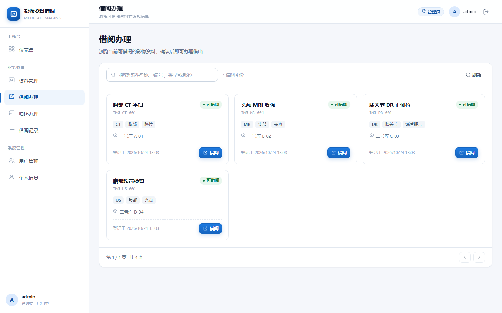

# 医学影像资料借阅管理系统

本科课程设计。已完成数据库、Python 业务层、FastAPI 接口层和原生 Web 前端，
通过一个地址即可登录使用，所有页面数据都来自真实的 SQLite 数据库。

## 技术栈

- 数据库：SQLite 3（`schema.sql` 建表，`queries.sql` 放具名 SQL）
- 后端：Python 3.11，`sqlite3` 标准库 + FastAPI，不使用 ORM
- 前端：原生 HTML + CSS + JavaScript（ES Modules + Fetch），不使用 Vue/React/TypeScript
- 部署：FastAPI 直接托管静态页面，前后端同源，无需 Node.js 或构建工具

## 页面预览

| 登录页 | 仪表盘 |
|---|---|
|  |  |

| 资料管理 | 借阅办理 |
|---|---|
|  |  |

## 目录结构

```
yy/
├── schema.sql              数据库结构（表、约束、索引）
├── queries.sql             30 条具名 SQL（-- name: xxx）
├── app/
│   ├── db.py               连接、具名 SQL 加载、事务、分页
│   ├── security.py         密码哈希、令牌生成
│   ├── timeutil.py         UTC 时间与库内文本格式互转
│   ├── permissions.py      角色权限判断
│   ├── auth.py             登录、令牌、失败限流
│   ├── users.py            用户业务（创建、停用、启用、角色）
│   ├── materials.py        资料业务（新增、修改、停用、启用）
│   ├── borrowing.py        借阅与归还业务
│   ├── audit.py            操作日志记录、查询与 CSV 导出
│   ├── imports.py          资料批量导入
│   ├── backup.py           数据库备份与恢复
│   ├── errors.py           业务异常（自带 HTTP 状态码）
│   ├── main.py             FastAPI 入口、错误映射、CORS、静态页面托管
│   └── api/                接口层（deps / schemas / routes_*）
├── frontend/
│   ├── index.html          页面骨架与 SVG 图标精灵
│   ├── css/style.css       医疗蓝主题、响应式布局
│   └── js/
│       ├── app.js          启动、登录态恢复、路由挂载
│       ├── api.js          Fetch 封装、令牌、统一错误处理
│       ├── auth.js         登录、登出、会话状态
│       ├── ui.js           弹窗、提示、分页、状态标签等组件
│       ├── views.js        登录页、应用外壳、仪表盘、个人信息
│       ├── materials.js    资料管理
│       ├── borrows.js      借阅、归还、借阅记录
│       ├── users.js        用户管理
│       ├── logs.js         操作日志查看与 CSV 导出
│       └── backup.js       数据库备份与恢复
├── scripts/                建库、演示、启动服务
├── tests/                  153 个 unittest 用例
├── docs/screenshots/       页面截图
├── requirements.txt
└── yy.db                   运行后生成的数据库文件
```

## 快速开始

```bash
# 1. 安装依赖
python -m pip install -r requirements.txt

# 2. 建库并写入演示数据
python scripts/init_db.py --reset --seed

# 3. 启动服务
python scripts/run_api.py --reload
```

打开浏览器访问 **http://127.0.0.1:8000/**，即可看到登录页并完成全部操作。
接口文档仍在 **http://127.0.0.1:8000/docs**。

演示账号：

| 账号 | 密码 | 角色 |
|---|---|---|
| `admin` | `admin123` | 管理员 |
| `staff` | `staff123` | 工作人员 |
| `viewer` | `viewer123` | 访客 |

其他命令：

```bash
python scripts/demo.py                    # 业务层流程演示（不经过 HTTP）
python -m unittest discover -s tests -v   # 全部自动化测试
python -m uvicorn app.main:app --reload   # 不经过 run_api.py 启动
```

> 开发提示：前端资源通过 `?v=0.9.1` 带版本号加载（见 `index.html` 和 `js/*.js` 的 import）。
> 修改前端文件后，请同步提升这些版本号并重启浏览器页面，避免浏览器继续使用旧模块。

## 前端功能

| 页面 | 功能 | 可见角色 |
|---|---|---|
| 登录 | 用户名密码登录、失败提示、登录中状态、令牌失效自动回登录页 | 所有人 |
| 仪表盘 | 资料总数、可借阅、已借出、我的在借、我的借阅、最近借阅、快捷入口 | 全部 |
| 资料管理 | 列表、关键词搜索、状态/检查类型/入库日期筛选、排序、分页、详情、新增、编辑、停用/启用、删除、借阅、CSV 批量导入 | 查询全部角色；维护仅 admin |
| 借阅办理 | 可借阅资料卡片、搜索、分页、确认后借阅、并发冲突提示 | admin / staff |
| 归还办理 | 未归还记录、逾期标识、二次确认、归还后自动刷新 | admin / staff |
| 借阅记录 | 资料、借阅人、借出/应还/归还时间、状态、关键词/状态/借出日期筛选、分页 | 全部 |
| 用户管理 | 用户列表、新增、停用/启用、角色调整、状态展示 | admin |
| 操作日志 | 按操作人/动作/日期筛选、分页、客户端 IP、登录失败记录、导出 CSV、归档清理 | admin |
| 数据备份 | 下载 SQLite 备份、上传备份恢复数据库（自动保存恢复前安全备份） | admin |

## 数据导入与备份

- **批量导入资料**：管理员在「资料管理」点「批量导入」，选择 CSV。表头可用英文字段
  `material_code,title,modality,body_part,material_type,storage_location`，也支持中文表头
  「资料编号、资料名称、影像检查类型、检查部位、资料载体、存放位置」。
  单次最多 500 行，逐行校验必填项和重复编号；允许部分成功，并返回每一行的失败原因。
- **下载备份**：「系统管理 → 数据备份」可下载当前数据库的 `.db` 文件，使用 SQLite 官方
  backup API 生成一致性快照。
- **恢复备份**：上传 `.db` 备份后恢复。服务端会校验文件完整性、必要数据表和是否存在启用的
  管理员账号；恢复前自动在 `backups/pre_restore_*.db` 保存当前数据库，恢复失败自动回滚。
  恢复成功后所有登录令牌清空，需要重新登录。
| 个人信息 | 用户名、角色、账户状态、权限说明、安全退出 | 全部 |

交互细节：

- 左侧导航 + 顶部信息栏 + 主内容区，桌面、平板、窄屏均有响应式布局；
- 加载中骨架屏、空数据提示、加载失败重试、操作成功/失败 Toast；
- 所有按钮在请求期间禁用，避免重复提交；
- 登录令牌保存在 `sessionStorage`，关闭标签页即失效；
- 所有用户数据使用 `textContent` 写入 DOM，不拼接 HTML，已通过浏览器 XSS 用例验证；
- 角色只控制界面入口，真正的权限由 FastAPI 后端校验（已测试 viewer 绕过页面直接调接口会返回 403）；
- 操作成功后重新请求后端数据，不使用本地假状态。

## 角色权限

| 操作 | admin | staff | viewer |
|---|---|---|---|
| 查询资料、借阅记录 | ✅ | ✅ | ✅ |
| 借阅 / 归还 | ✅ | ✅ | ❌ |
| 新增 / 修改 / 停用 / 启用资料 | ✅ | ❌ | ❌ |
| 删除资料（默认保护历史，可强制删除） | ✅ | ❌ | ❌ |
| 批量导入资料 | ✅ | ❌ | ❌ |
| 用户列表、创建、停用、启用、改角色 | ✅ | ❌ | ❌ |
| 查看 / 导出操作日志 | ✅ | ❌ | ❌ |
| 下载 / 恢复数据库备份 | ✅ | ❌ | ❌ |
| 查看自己的账户 | ✅ | ✅ | ✅ |

## HTTP 接口一览

除登录和健康检查外，都需要请求头 `Authorization: Bearer <token>`。

| 方法 | 路径 | 权限 | 说明 |
|---|---|---|---|
| GET | `/` | 公开 | 前端页面 |
| GET | `/health` | 公开 | 健康检查 |
| POST | `/auth/login` | 公开 | 登录，失败 5 次后限流 |
| GET | `/auth/me` | 登录 | 当前用户 |
| POST | `/auth/logout` | 登录 | 注销令牌 |
| GET | `/users` | admin | 用户列表（支持 limit/offset） |
| POST | `/users` | admin | 创建用户 |
| GET | `/users/{id}` | admin / 本人 | 查询用户 |
| POST | `/users/{id}/disable` | admin | 停用用户 |
| POST | `/users/{id}/enable` | admin | 启用用户 |
| PATCH | `/users/{id}/role` | admin | 调整角色（不能改自己） |
| GET | `/logs` | admin | 操作日志列表（支持 username/action/start/end/limit/offset） |
| GET | `/logs/export.csv` | admin | 导出筛选后的操作日志 CSV |
| POST | `/logs/archive` | admin | 归档并删除截止日期前的日志 |
| GET | `/materials` | 登录 | 全部资料（支持 limit/offset） |
| GET | `/materials/available` | 登录 | 可借阅资料（支持 limit/offset） |
| POST | `/materials` | admin | 新增资料 |
| POST | `/materials/import` | admin | 批量导入资料（CSV 解析后的行数据，最多 500 行） |
| GET | `/materials/{id}` | 登录 | 资料详情 |
| PATCH | `/materials/{id}` | admin | 修改资料 |
| POST | `/materials/{id}/disable` | admin | 停用资料 |
| POST | `/materials/{id}/enable` | admin | 启用已停用的资料 |
| DELETE | `/materials/{id}` | admin | 删除资料；`?force=true` 时连同借阅历史一起删除 |
| GET | `/borrows/active` | 登录 | 未归还记录（支持 limit/offset） |
| GET | `/borrows/history` | 登录 | 借阅历史（支持 limit/offset） |
| GET | `/borrows/overdue` | 登录 | 逾期记录（支持 limit/offset） |
| GET | `/borrows/{material_id}` | 登录 | 某资料的当前借阅 |
| POST | `/borrows` | admin / staff | 借阅（body：material_id、可选 due_at） |
| POST | `/borrows/{material_id}/return` | admin / staff | 归还 |
| GET | `/backup/database` | admin | 下载 SQLite 数据库备份 |
| POST | `/backup/restore` | admin | 上传备份并恢复数据库 |

前端列表页在一次性获取全量数据后做本地搜索、筛选和分页（课程数据量小）；
后端本身支持 `?limit=&offset=`，数据量增大时可直接改为服务端分页。

## 错误格式

所有错误统一返回 `{code, message}`：

```json
{"code": "conflict", "message": "该资料当前不是可借阅状态，无法借阅"}
```

| HTTP 状态 | code | 含义 |
|---|---|---|
| 401 | `authentication_error` | 未登录、令牌失效、密码错误 |
| 403 | `permission_denied` | 角色不允许 |
| 404 | `not_found` | 记录或路由不存在 |
| 405 | `method_not_allowed` | 请求方法不对 |
| 409 | `conflict` | 重复借阅、重复归还、重复编号等 |
| 422 | `validation_error` | 参数不合法 |
| 429 | `too_many_attempts` | 登录失败次数过多 |
| 500 | `internal_error` | 未预料的服务器异常 |
| 503 | `database_busy` | 数据库被占用超时 |

前端会针对 401/403/404/409/429/503 给出对应提示，网络异常和超时也有单独文案。

## 认证与安全

- 登录成功返回随机令牌，默认 8 小时过期，只存进程内存；
- 每次请求重新查库确认用户状态和角色，**停用账户或调整角色后旧令牌立即失效/降权**；
- 同一用户名 + IP 连续失败 5 次后限流 5 分钟，返回 429 与 `Retry-After`；
- 密码使用 PBKDF2-HMAC-SHA256 加盐哈希，页面和接口都不返回密码哈希；
- CORS 默认只放行本地开发地址，可用 `YY_CORS_ORIGINS` 覆盖；
- 前端不使用 `innerHTML` 渲染用户数据，避免 XSS。

## 数据库

四张表：`users`、`materials`、`borrow_records`、`operation_logs`。

- `operation_logs` 记录登录、资料维护、借阅归还、用户管理等操作；
  保存操作人/角色的当时快照，不建外键，保证账号变化后日志仍可追溯。

关键约束：

- `uq_borrow_records_active_material` 部分唯一索引：同一资料只能有一条未归还记录；
- `uq_users_username_nocase`、`uq_materials_code_nocase`：用户名和资料编号大小写不敏感唯一；
- `CHECK` 保证归还时间不早于借阅时间；
- 归还后记录保留，资料可再次借阅。

SQLite 外键默认关闭，`app/db.py` 在**每个新连接**上执行 `PRAGMA foreign_keys = ON`。
旧库启动时会自动补建新增索引；若旧数据存在只差大小写的重复项，启动时会给出明确提示，
检查 SQL 见 `schema.sql` 注释。

## 事务与并发

借阅、归还都在一个 `BEGIN IMMEDIATE` 事务里完成：

- 借阅：`mark_material_borrowed`（WHERE status='available'）→ `create_borrow_record`；
- 归还：`get_active_borrow_by_material` → `return_borrow_record`（WHERE returned_at IS NULL）
  → `mark_material_available`（WHERE status='borrowed'）。

每步检查 `rowcount == 1`，否则抛 `ConflictError` 并整体回滚；部分唯一索引是并发下的最后防线。
FastAPI 的同步依赖与路由可能在不同线程执行，因此连接使用 `check_same_thread=False`，
但每个请求独占一个连接，不会并发使用同一连接。

## 测试

`python -m unittest discover -s tests -v` 共 **153** 个用例，全部通过：

- 数据库约束、外键、CHECK、唯一索引、部分唯一索引；
- 借阅 / 归还状态流转、重复借阅拦截、历史保留、归还后再借；
- 角色权限、停用/启用、角色变更、首管理员规则；
- 资料停用后可以重新启用，非法状态转换返回 409；
- 登录限流 429、令牌失效、大小写规则；
- 停用账号时吊销全部令牌，重新启用不会让旧令牌复活；
- 会话存储按应用实例隔离，不同应用实例之间的令牌不通用；
- 分页参数（limit/offset）、统一错误格式、CORS、超范围 id、畸形 JSON；
- 事务中途失败回滚、连接生命周期（请求结束后数据库文件可删除）；
- 并发读、并发借阅唯一性；
- 操作日志：登录/新增/借阅/归还等动作写入日志，管理员可查询和导出 CSV；
- 操作日志增强：记录客户端 IP，登录失败也会写入日志；
- 批量导入：成功、部分失败、空编号、重复编号、超过 500 行和 staff 越权；
- 资料筛选排序：关键词 + 状态 + 检查类型 + 入库日期组合，以及按名称/编号/状态排序（日期按本地时间）；
- 资料删除：默认拒绝删除有借阅历史的资料，`force=true` 可连同历史删除；
- 操作日志：服务端按操作人/动作/日期筛选，筛选后导出，归档到 CSV 后清理（日期自动换算为 UTC）；
- 借阅记录：关键词 + 状态 + 借出日期组合筛选（日期按本地时间）；
- 备份恢复：下载 SQLite 备份、恢复后数据回退、旧令牌失效、非法备份不破坏数据；
- 备份安全：损坏文件、结构不完整文件、缺少管理员、空文件和外键异常都会被拒绝；
- 前端静态页面与资源托管、API 路由不被静态挂载遮蔽。

**真实浏览器测试**：使用系统 Edge 无头模式 + CDP 驱动，完成了：

- 登录失败/成功、空表单校验、429 限流提示、仪表盘统计；
- 资料新增/编辑/重复编号校验、双击只创建一次、ESC 关闭弹窗；
- 分页、空搜索结果、停用资料后借阅页同步过滤；
- 借阅、归还、借阅记录状态刷新；
- 用户新增、停用、启用、角色调整、用户分页；
- 批量导入 CSV、下载数据库备份、用备份恢复并确认导入数据被回退；
- 资料删除：无记录直接删除；有借阅记录时二次确认后连同历史强制删除；
- 日志筛选、日期范围筛选和归档操作；
- 管理员修改角色后，已登录用户的页面在切回标签页/切换页面时自动刷新导航；
- staff / viewer 的导航与接口权限校验（含绕过前端直接调接口返回 403）；
- 弱网下快速切换菜单，慢请求不会覆盖新页面；
- XSS 用例（资料标题中的 `<b>` 按纯文本显示）；
- 令牌失效后自动回到登录页，浏览器控制台无未捕获异常。

## 已知限制

- 令牌和登录限流都保存在进程内存，多 worker 部署不共享，服务重启后需要重新登录；
- 没有密码修改接口；目前只有操作日志支持 CSV 导出，资料和借阅数据没有单独的导出/批量导入历史；
- 删除资料默认保护借阅历史；强制删除会连同借阅记录一起删除，需要二次确认；
- 支持关键词/状态/检查类型/入库日期、借阅日期等组合筛选，暂不支持跨表任意 JOIN 或自然语言查询；
- 操作日志支持筛选和手工归档，但没有自动定时清理策略；
- 数据库恢复要求核心表字段完整；缺少 operation_logs 的旧备份会自动补建，更早且结构不兼容的备份仍会被拒绝；
- 资料/借阅列表的筛选和分页仍在前端本地完成，数据量很大时应改为服务端查询；
- CORS 默认只允许本地开发地址，部署到其它域名需设置 `YY_CORS_ORIGINS`；
- 浏览器自动化测试依赖本机 Edge 与临时脚本，未纳入项目依赖和 CI。
